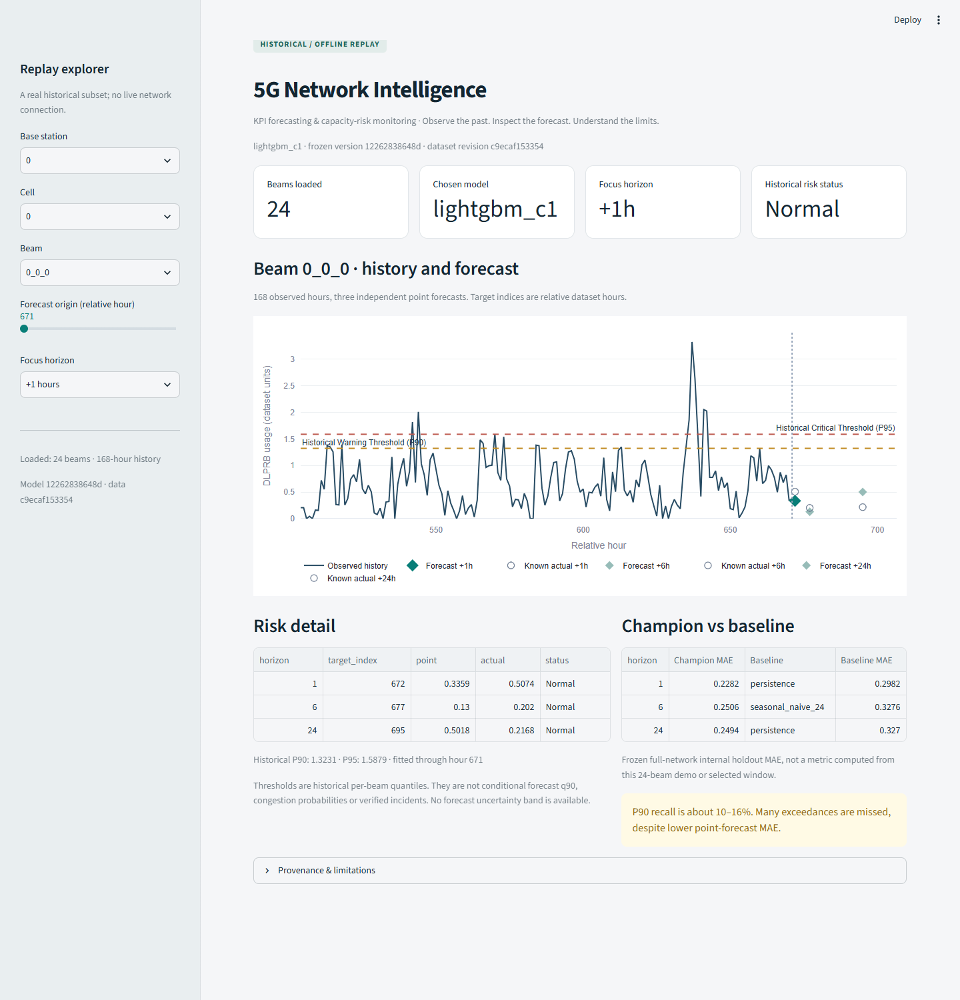

# 5G Network Intelligence

**5G Network Intelligence: KPI Forecasting & Capacity Risk Monitoring**

A reproducible 5G beam-level KPI forecasting and historical capacity-risk monitoring
system using LightGBM, GRU, FastAPI, Streamlit, and Docker.

Code: [MIT license](LICENSE), copyright 2026 Truong Bao Kien. Dataset attribution
and its MIT declaration remain in [the pinned dataset card](dataset_card.md).

**Release:** [v1.0.0](https://github.com/trbk07/5g-network-intelligence/releases/tag/v1.0.0)
includes the verified demo package and champion manifest. The repository remains
private; release assets require repository access. Download the package, then run
`python -m scripts.fetch_demo_assets --demo-archive PATH_TO_5g-demo-assets.tar.gz`
and `docker compose up --build -d --wait`.

**Problem:** beam-level usage changes make future load hard to inspect from raw
KPI tables. This project forecasts usage at +1/+6/+24 hours and shows historical
P90/P95 exceedance scenarios through an explicitly offline replay dashboard.

| Internal holdout | 1h | 6h | 24h |
| --- | ---: | ---: | ---: |
| Champion MAE | 0.228237 | 0.250562 | 0.249446 |
| Validation-selected baseline MAE | 0.298215 | 0.327570 | 0.326987 |
| MAE reduction | 23.47% | 23.51% | 23.71% |

Evaluation is chronological, uses common finite pairs and preserves a pre-holdout
freeze. Historical risk is not verified congestion; P90 recall is only about
10-16%. See the [model card](docs/model_card.md), [experiment report](reports/experiment_report.md)
and [limitations](docs/limitations.md).

**Current product:** Weeks 1-7 are implemented. The historical replay dashboard
and five-endpoint API run on CPU with the frozen Week 6 champion. See
[Week 7 startup and verification](docs/week7.md) and
[product evidence](reports/week7_product_evidence.json).

```powershell
# Prepare 24 verified real-data demo beams from the completed Week 6 artifacts.
.venv/Scripts/python.exe -m scripts.fetch_demo_assets
docker compose up --build -d --wait
```

Open [the dashboard](http://127.0.0.1:8501) or [API docs](http://127.0.0.1:8000/docs).
Watch the [two-minute walkthrough](docs/demo_walkthrough.webm), or inspect the
[real API screenshot](docs/screenshots/api_docs.png).
For an authorized clean clone, asset setup supports `--download` from existing
private Kaggle outputs; no public release asset is assumed. The app never trains.



Week 7 model research is isolated to the original fit/validation ranges. It
does not replace the frozen champion or reuse the final holdout for selection.
Review [the commented notebook](notebooks/07_product_and_research.ipynb).
Cloud research completed 12 fits: `deeper_l1` reduces mean normalized validation
MAE by **0.337%** (a small exploratory gain). It is saved separately as a research
candidate; the deployed champion and final holdout remain unchanged. See
[Week 7 results and trade-offs](reports/week7_results.md).

The subsequent chronological search improves mean normalized validation MAE by
**0.878% vs C1** and **0.543% vs the Week 7 candidate**. Its causal40 ensemble
combines dense-origin LightGBM with a seasonal residual model at 1h and
LightGBM/CatBoost at 6h/24h. See [measured results](reports/model_improvement_results.md)
and [the report-only notebook](notebooks/08_model_improvement_review.ipynb).
This is an independently loadable research candidate; fresh unseen chronological
data is required before promotion. The frozen dashboard champion remains intact.

Later transfer, hurdle and neural studies are reconciled in the
[common-population research comparison](reports/research_validation_comparison.md).
The latest fixed 80/20 hurdle/MLP-B blend has validation MAE
**0.226480 / 0.249664 / 0.248324** at 1/6/24h, lower point estimates than the
prior Linear blend and other cases in that selected research table. Architecture,
weights and the ten-epoch refit were fixed before this audit. See the
[audit and trade-offs](reports/mlp_blend_candidate_analysis.md) and
[review notebook](notebooks/23_fixed_mlp_blend_candidate_audit.ipynb).
Zero false-positive rates worsen. The [fixed-threshold risk audit](reports/research_risk_analysis.md)
shows higher recall/F1 than hurdle but many missed historical exceedances. WAPE remains **40.80% / 44.28% / 44.79%**,
above the 10% research target. Repeated validation does not establish unseen
future accuracy or absence of overfitting. The frozen production model remains
unchanged; no original holdout was replayed for this research.

The repository contains dataset ingestion, provenance, panel construction,
forecasting, historical-risk replay and application components described in
[the execution plan](plan5G.md). Original release evidence and later exploratory
model-quality work remain separately documented.

Week 2 adds chronological origins, metrics with coverage flags, a history-only
evaluator, three baselines and leakage canaries. Run the validation benchmark:

```powershell
.venv/Scripts/python.exe -m scripts.run_baselines --segment val
```

See [evaluation protocol](docs/evaluation.md), [baseline analysis](reports/baseline_analysis.md)
and `notebooks/02_baselines.ipynb`. Validation results are not final holdout results.

LightGBM uses the updated **40-feature** causal contract. Legacy Week 3 44-feature
and Week 4 static6 artifacts were rejected and retrained on cloud in Week 5. Run training
inside hosted Colab/Kaggle only (local training is forbidden by the owner):

```powershell
python -m scripts.train_lgbm
python -m scripts.evaluate_models --model lightgbm --segment val
```

See [LightGBM protocol](docs/lightgbm.md), [validation analysis](reports/lightgbm_analysis.md)
and `notebooks/03_lightgbm.ipynb`. The observed selected configuration is C1;
Week 5 produces a champion-ready candidate only; Week 6 performs the final freeze
and holdout evaluation under the updated [plan](plan5G.md).

Week 4 adds GRU-A/B input preprocessing, beam sampling, resumable GPU training
and validation replay. See [GRU protocol](docs/gru.md) and the
[GPU pilot measurements](reports/gru_compute.md). Full neural training requires CUDA.
All training, including synthetic fitting tests, runs only on hosted Colab/Kaggle.
Local test runs automatically skip tests marked `cloud_training`.
Use [the commented GRU review notebook](notebooks/04_gru_review.ipynb) to inspect
the code, debug one beam and view the measured comparison. It does not retrain
on Run All. All four GRU runs finished on Kaggle; C1 remains better on validation.

Week 5 quality/research evidence is in [the quality gate](reports/model_quality_gate.md),
[common-mask analysis](reports/model_analysis.md) and [error atlas](reports/error_atlas.md).
Candidate metadata is in `configs/champion_candidate.yaml`: **not frozen**, holdout disabled.
P1 quantile bands were skipped because all legacy models required cloud retraining.
Use [the Week 5 review notebook](notebooks/05_model_quality.ipynb) for code, coverage,
paired intervals and the atlas; Run All does not train or reopen holdout.

```powershell
# Read existing artifacts/forecasts and perform statistics only; no fitting occurs.
.venv/Scripts/python.exe -m scripts.quality_audit
.venv/Scripts/python.exe -m scripts.evaluate_models --model lightgbm --segment val --diagnostics
```

Week 6 is complete: LightGBM C1 was frozen at tag `pre-holdout`, refitted on
hosted Kaggle CPU with 284/457/414 fixed rounds and evaluated once on the internal
holdout. No local training or holdout tuning occurred. The deployment configuration
is `configs/champion.yaml`; Week 5 candidate metadata remains a historical record.

| Horizon | Holdout MAE | Best validation baseline MAE | MAE reduction |
| --- | ---: | ---: | ---: |
| 1h | 0.228237 | 0.298215 | 23.47% |
| 6h | 0.250562 | 0.327570 | 23.51% |
| 24h | 0.249446 | 0.326987 | 23.71% |

All three paired BS-bootstrap 95% MAE-difference intervals favor C1. Historical
P90 recall is only 10-16%, so the alerting limitation remains explicit.
See [final evidence and limitations](reports/week6_results.md),
[the Week 6 protocol](docs/week6.md) and
[the readable review notebook](notebooks/06_champion_risk_holdout.ipynb).
The [private Kaggle review](https://www.kaggle.com/code/truongbaokien/5g-network-intelligence-week6-review)
displays saved results and never retrains on Run All. Checkpoints remain in
the [completed private execution Output](https://www.kaggle.com/code/truongbaokien/5g-network-intelligence-week6-final/output).

## Run Week 1

Requires Python 3.12+ and internet access for the public dataset.
Run commands from the repository root (PowerShell):

```powershell
uv venv --python 3.12 .venv
uv pip install --python .venv/Scripts/python.exe -e ".[dev,ml,neural]"
.venv/Scripts/python.exe -m scripts.prepare_data --step all
.venv/Scripts/python.exe -m pytest -q
.venv/Scripts/ruff.exe check .
```

Or activate a standard Python virtual environment and use `pip install -e ".[dev,ml,neural]"`.
Individual pipeline stages: `--step download`, `--step panel`, `--step audit`.
Configuration lives in `configs/data.yaml`; paths resolve from the working directory.
`requirements-week1.lock.txt` records the validated environment.
The panel stage also writes `configs/evaluation.yaml` from the resolved split
decision, keeping it consistent with `data/processed/split.json`. Source manifests
reject missing or unexpected CSVs in addition to checksum mismatches.

For cloud setup, use [the Colab/Kaggle bootstrap notebook](notebooks/00_runtime_setup.ipynb)
and [infrastructure instructions](docs/infra.md). It checks the actual GPU and
checkpoint storage; cloud access and GPU quota must be verified in your own session.

## Data and methodology

Dataset: [NETOP GOTS-F](https://huggingface.co/datasets/netop/gotsf-ds), MIT license.
The revision is pinned in configuration; the downloaded card and file checksums
are retained. Please cite Fechete et al., “Goal-Oriented Time-Series Forecasting:
Foundation Framework Design,” as requested by the dataset authors.

Four hourly KPIs are aligned on numeric time and `(BS, cell, beam)` identifiers.
NaN remains missing; zero remains observed. Missing keys are outer-aligned as NaN;
duplicate keys, nonnumeric values and infinities raise errors. Never silently drop rows.
DLPRB is described as **usage**, since its physical unit is unverified.

The conservative default uses train indices 0–503 for fit, 504–671 for validation,
and 672–839 for internal holdout. Week 6 and week 11 remain separate. Primary
splitting requires a documented continuity review and matching source indices.
Do not train before reviewing `reports/split_decision.md` and `split.json`.

## Outputs

| Path | Content |
| --- | --- |
| `data/raw/` | Revision-pinned source CSVs, card and provenance |
| `data/processed/panel.npz` | Main time × beam × KPI panel |
| `data/processed/panel_meta.json` | Panel schema and provenance |
| `data/processed/week6.npz`, `week11.npz` | Separate target weeks |
| `data/processed/split.json` | Inclusive chronological split bounds |
| `reports/data_manifest.json` | SHA256, size, rows, columns, revision, license |
| `reports/data_audit.md`, `data_audit.json` | Audit summary and machine-readable detail |
| `reports/figures/data_audit.png` | Distribution, zeros, sample series, phase profiles |
| `reports/run_metadata.json` | Config, hash, seed, package versions, Git commit |

Audit figures include holdout observations for Week 1 data verification only;
do not use them to tune models. Final internal holdout and historical risk results
are recorded in [the Week 6 report](reports/week6_results.md).
This project is historical/offline replay, not live network telemetry. Statistical
threshold exceedance is not verified congestion or incident detection.

GitHub repository name: `5g-network-intelligence`. Dashboard name: **5G Network
Intelligence**. CV title: **5G Network Intelligence — KPI Forecasting & Capacity
Risk Monitoring**.
