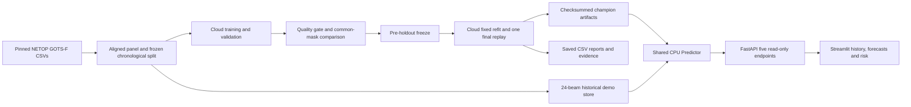

# Architecture

Only hosted Colab/Kaggle runs training, early stopping and ensemble calibration.
Local code prepares sources, verifies data, runs non-training tests, orchestrates
cloud jobs and performs CPU inference. The production path never fits a model.

The API loads checksummed models once during lifespan startup. ReplayStore
holds immutable panel arrays and returns history copies. Predictor uses the
offline causal feature builder and serializes native model calls. Actual target
values are attached only after predicting for historical display. Missing assets
yield readiness 503; invalid origins/batches yield 422 and unknown beams 404.

Dashboard numbers and risk states come from the same API. Read-only Docker
services mount demo assets, use non-root users and expose ports on localhost.
The model version, data revision, replay badge and loaded subset count are visible.

Research target recipes and ensembles use separate schemas/directories. They
cannot replace ordinary champion artifacts by accident. Frozen holdout reports
are checksum-verifiable, and the final replay guard refuses duplicate attempts
within its persisted workspace. Submission provenance records the single job.
