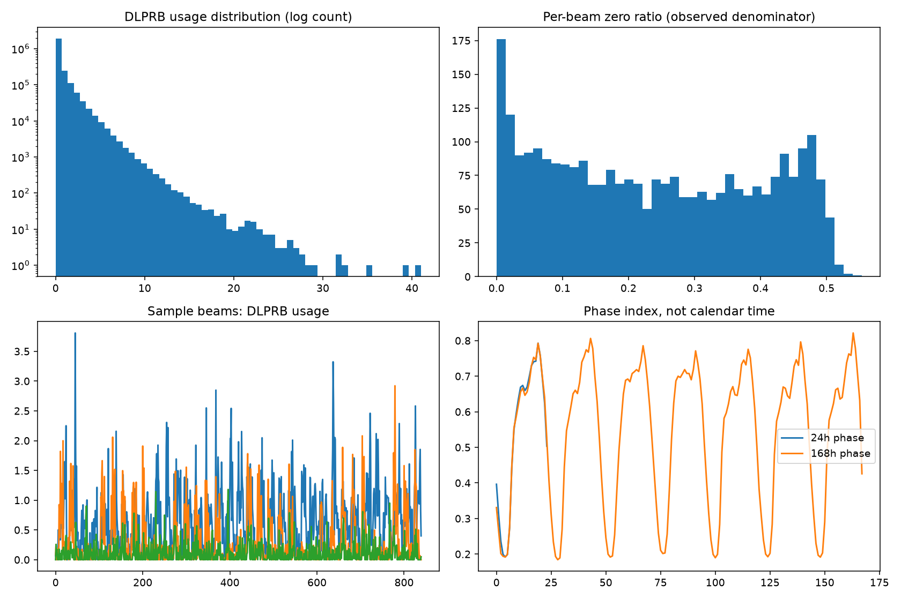

# Data audit

Descriptive audit of the main panel; no imputation or filtering.

NaN is preserved; zero is a valid observation. DLPRB unit remains unverified; use **DLPRB usage**. Active means value > 0 among observed values.

```json
{
  "shape": [
    840,
    2880,
    4
  ],
  "zeros": {
    "DLPRB": {
      "observed": 2419200,
      "zero_ratio": 0.23770089285714285,
      "active_ratio": 0.7622991071428571
    },
    "DLThpVol": {
      "observed": 2419200,
      "zero_ratio": 0.3176012731481481,
      "active_ratio": 0.6823987268518519
    },
    "DLThpTime": {
      "observed": 2419200,
      "zero_ratio": 0.2775624173280423,
      "active_ratio": 0.7224375826719577
    },
    "MR_number": {
      "observed": 2419200,
      "zero_ratio": 0.2015252976190476,
      "active_ratio": 0.7984747023809524
    }
  },
  "range": {
    "DLPRB": {
      "negative_count": 0,
      "quantiles": [
        0.0,
        0.17499114960980106,
        1.4973200296328955,
        2.4342598313454844,
        41.02625273930377
      ]
    },
    "DLThpVol": {
      "negative_count": 0,
      "quantiles": [
        0.0,
        0.09518059913957586,
        0.7803625224337801,
        1.3868431443119744,
        245.3745519318441
      ]
    },
    "DLThpTime": {
      "negative_count": 0,
      "quantiles": [
        0.0,
        0.1293085452084844,
        1.1030814033835301,
        1.902866264902238,
        84.20681688499391
      ]
    },
    "MR_number": {
      "negative_count": 0,
      "quantiles": [
        0.0,
        0.22734210126119148,
        1.6323806058508035,
        2.545412636135435,
        33.665977541818336
      ]
    }
  },
  "duplicates": {
    "duplicate_time_keys": 0,
    "duplicate_beam_ids": 0,
    "source_files": {
      "DLPRB": {
        "rows": 840,
        "beams": 2880,
        "unnamed_time_column": true,
        "duplicate_time_keys": 0,
        "duplicate_beam_columns": 0
      },
      "DLThpVol": {
        "rows": 840,
        "beams": 2880,
        "unnamed_time_column": true,
        "duplicate_time_keys": 0,
        "duplicate_beam_columns": 0
      },
      "DLThpTime": {
        "rows": 840,
        "beams": 2880,
        "unnamed_time_column": true,
        "duplicate_time_keys": 0,
        "duplicate_beam_columns": 0
      },
      "MR_number": {
        "rows": 840,
        "beams": 2880,
        "unnamed_time_column": true,
        "duplicate_time_keys": 0,
        "duplicate_beam_columns": 0
      }
    }
  },
  "beams": {
    "complete_expected_mapping": true,
    "within_expected_bounds": true,
    "base_stations": 30,
    "cells": 90,
    "beams": 2880,
    "all_missing_target_beams": 0,
    "constant_target_beams": 0
  }
}
```

Missing ratios per KPI: {'DLPRB': 0.0, 'DLThpVol': 0.0, 'DLThpTime': 0.0, 'MR_number': 0.0}

Full per-beam missing ratios: data_audit.json.


