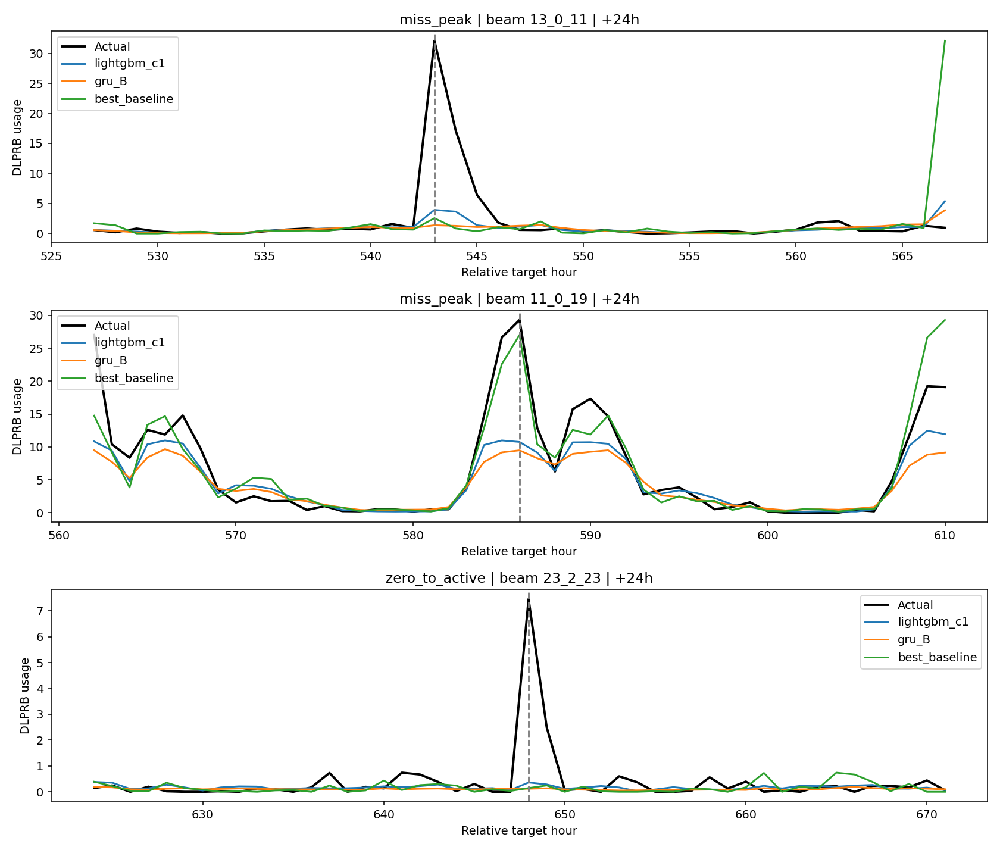
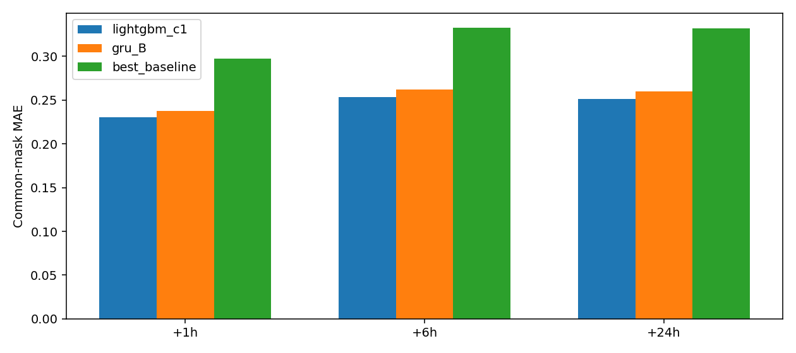
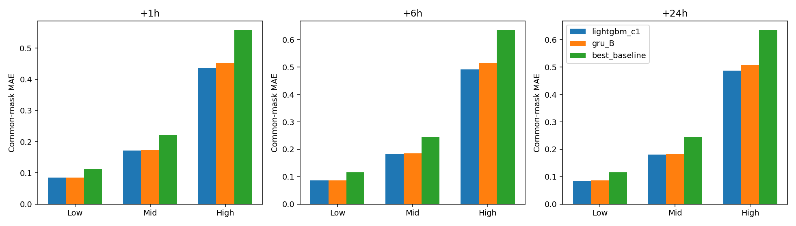

# Validation error atlas

Reference family: lightgbm_c1.
Selection rules: top 5 beams by equal-weight mean per-horizon reference MAE;
five equally spaced fit-load ranks per Low/Mid/High tier; two largest distinct
+24h underpredictions among actual >= validation P90, plus one largest zero-to-active miss.
Ties use original numeric beam/time order. No manual/cherry-picked cases.
Cases are retrospective error diagnostics, not incident/congestion labels.

## Beam selections

```csv
selection,beam_id,load_tier,mae
top5_reference_mean_horizon_mae,22_2_13,High,2.293917927925654
top5_reference_mean_horizon_mae,19_2_15,High,2.2219406467919165
top5_reference_mean_horizon_mae,11_0_19,High,1.6587522584837995
top5_reference_mean_horizon_mae,2_2_14,High,1.606642275981935
top5_reference_mean_horizon_mae,23_1_21,High,1.544362622382139
five_evenly_spaced_fit_load_ranks,3_0_24,Low,0.053469392648531566
five_evenly_spaced_fit_load_ranks,21_0_8,Low,0.07254467142107136
five_evenly_spaced_fit_load_ranks,27_1_17,Low,0.09069536012284156
five_evenly_spaced_fit_load_ranks,1_0_3,Low,0.10250848973498339
five_evenly_spaced_fit_load_ranks,6_1_16,Low,0.10573587958714166
five_evenly_spaced_fit_load_ranks,26_2_12,Mid,0.1533973426424399
five_evenly_spaced_fit_load_ranks,0_0_29,Mid,0.15095265998248927
five_evenly_spaced_fit_load_ranks,9_0_26,Mid,0.12671044127440323
five_evenly_spaced_fit_load_ranks,7_1_23,Mid,0.1903515845556812
five_evenly_spaced_fit_load_ranks,9_1_3,Mid,0.23905127740959706
five_evenly_spaced_fit_load_ranks,4_2_5,High,0.14523417168036293
five_evenly_spaced_fit_load_ranks,12_1_4,High,0.365782663782886
five_evenly_spaced_fit_load_ranks,25_1_19,High,0.44708663748544963
five_evenly_spaced_fit_load_ranks,12_0_19,High,0.3814693151489981
five_evenly_spaced_fit_load_ranks,24_0_17,High,1.3353651245700782
```

## Peak/transition cases

```csv
case,beam_id,beam_index,origin_row,origin,target,actual,prediction,underprediction
miss_peak,13_0_11,1259,16,519,543,32.11031627395929,3.9288178016822375,28.181498472277056
miss_peak,11_0_19,1075,59,562,586,29.32094938026356,10.754197314519523,18.566752065744037
zero_to_active,23_2_23,2295,121,624,648,7.453163804621758,0.3612229538438239,7.091940850777934
```



