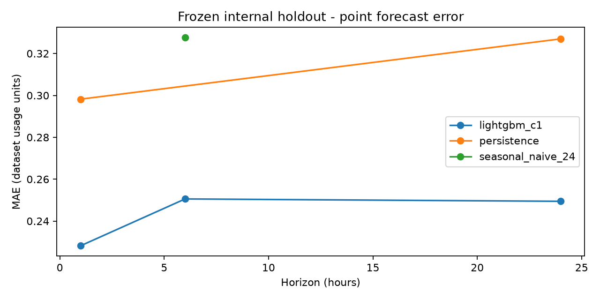

# Experiment report

Generated by `python -m scripts.build_report` from existing CSV evidence. No training or final replay is performed.

## Questions and data

Can a global causal model outperform persistence and seasonal baselines at 1/6/24 hours? Do extra KPI channels improve GRU forecasts? Does lower point error imply useful historical exceedance alerts?
NETOP GOTS-F, pinned revision c9ecaf153354b2cc415c64750a966c47c7f3f6ac: 840 hourly steps, 2880 beams, four KPIs. DLPRB is usage in unverified physical units. Missing observations remain NaN; observed zeros stay zero. See data_audit.md and data_manifest.json.

## Protocol, coverage and leakage

Fallback chronological split: fit 0-503, validation 504-671, final development 0-671, internal holdout 672-839. External weeks are excluded because temporal continuity is unverified. Fixed-model rolling origins consume only observations through each origin, with 168-step histories.
LightGBM has 40 causal inputs, no fit-beam summaries. GRU A/B use global per-KPI preprocessing and exactly four deterministic phase features. Legacy static-summary artifacts were rejected in Week 5 and retrained on cloud.
Common finite pairs align actuals, predictions, origins and beams. Pooled validation comparison contains 168/163/145 origins and 2880 beams at the respective horizons; see model_comparison_val.csv for exact coverage. Leakage tests perturb future observations; inference parity verifies saved batch forecasts against history-only inference.

## Validation comparison

| model | horizon | mae | rmse | wape | n_valid | coverage_pct |
| --- | --- | --- | --- | --- | --- | --- |
| persistence | 1 | 0.297747 | 0.564116 | 0.536343 | 483840 | 100.000000 |
| persistence | 6 | 0.496920 | 1.016179 | 0.881394 | 469440 | 100.000000 |
| persistence | 24 | 0.332065 | 0.631948 | 0.598915 | 417600 | 100.000000 |
| seasonal_naive_24 | 1 | 0.329941 | 0.626592 | 0.594335 | 483840 | 100.000000 |
| seasonal_naive_24 | 6 | 0.332699 | 0.630179 | 0.590113 | 469440 | 100.000000 |
| seasonal_naive_24 | 24 | 0.332065 | 0.631948 | 0.598915 | 417600 | 100.000000 |
| seasonal_naive_168 | 1 | 0.335836 | 0.642092 | 0.604953 | 483840 | 100.000000 |
| seasonal_naive_168 | 6 | 0.338695 | 0.646273 | 0.600747 | 469440 | 100.000000 |
| seasonal_naive_168 | 24 | 0.336674 | 0.644678 | 0.607227 | 417600 | 100.000000 |
| lightgbm_c1 | 1 | 0.230635 | 0.446024 | 0.415450 | 483840 | 100.000000 |
| lightgbm_c1 | 6 | 0.253473 | 0.496767 | 0.449588 | 469440 | 100.000000 |
| lightgbm_c1 | 24 | 0.251246 | 0.493935 | 0.453150 | 417600 | 100.000000 |
| lightgbm_c2 | 1 | 0.238861 | 0.434105 | 0.430268 | 483840 | 100.000000 |
| lightgbm_c2 | 6 | 0.264953 | 0.485783 | 0.469951 | 469440 | 100.000000 |
| lightgbm_c2 | 24 | 0.263352 | 0.486312 | 0.474984 | 417600 | 100.000000 |
| gru_A_seed17 | 1 | 0.240735 | 0.474048 | 0.433645 | 483840 | 100.000000 |
| gru_A_seed17 | 6 | 0.269617 | 0.554669 | 0.478223 | 469440 | 100.000000 |
| gru_A_seed17 | 24 | 0.262563 | 0.530507 | 0.473561 | 417600 | 100.000000 |
| gru_A_seed42 | 1 | 0.239944 | 0.473226 | 0.432220 | 483840 | 100.000000 |
| gru_A_seed42 | 6 | 0.270589 | 0.559133 | 0.479947 | 469440 | 100.000000 |
| gru_A_seed42 | 24 | 0.261948 | 0.530460 | 0.472451 | 417600 | 100.000000 |
| gru_B_seed17 | 1 | 0.239039 | 0.478797 | 0.430590 | 483840 | 100.000000 |
| gru_B_seed17 | 6 | 0.268118 | 0.552481 | 0.475565 | 469440 | 100.000000 |
| gru_B_seed17 | 24 | 0.262297 | 0.530600 | 0.473081 | 417600 | 100.000000 |
| gru_B_seed42 | 1 | 0.238583 | 0.473743 | 0.429769 | 483840 | 100.000000 |
| gru_B_seed42 | 6 | 0.260969 | 0.527987 | 0.462884 | 469440 | 100.000000 |
| gru_B_seed42 | 24 | 0.259670 | 0.529035 | 0.468341 | 417600 | 100.000000 |
| gru_A | 1 | 0.239377 | 0.471789 | 0.431199 | 483840 | 100.000000 |
| gru_A | 6 | 0.267584 | 0.551507 | 0.474617 | 469440 | 100.000000 |
| gru_A | 24 | 0.261021 | 0.528409 | 0.470779 | 417600 | 100.000000 |
| gru_B | 1 | 0.237515 | 0.473973 | 0.427844 | 483840 | 100.000000 |
| gru_B | 6 | 0.261959 | 0.534555 | 0.464641 | 469440 | 100.000000 |
| gru_B | 24 | 0.259636 | 0.527671 | 0.468281 | 417600 | 100.000000 |

## GRU ablation

| variant | horizon | seeds | mae_mean | mae_sd | n_pairs | comparison |
| --- | --- | --- | --- | --- | --- | --- |
| A | 1 | 2 | 0.240340 | 0.000560 | 483840 | same origins, beam sample, seeds and common finite target mask |
| A | 6 | 2 | 0.270103 | 0.000687 | 469440 | same origins, beam sample, seeds and common finite target mask |
| A | 24 | 2 | 0.262256 | 0.000435 | 417600 | same origins, beam sample, seeds and common finite target mask |
| B | 1 | 2 | 0.238811 | 0.000323 | 483840 | same origins, beam sample, seeds and common finite target mask |
| B | 6 | 2 | 0.264543 | 0.005055 | 469440 | same origins, beam sample, seeds and common finite target mask |
| B | 24 | 2 | 0.260983 | 0.001858 | 417600 | same origins, beam sample, seeds and common finite target mask |
Two seeds per variant were trained on hosted GPU. A uses target history, B adds the other KPIs; preprocessing and sampling follow the frozen contract. Seed means are distinct from ensemble-mean forecasts in the model comparison. Two seeds and this single dataset are limited evidence; C1 remained preferable on validation.

## Frozen holdout

Freeze commit: `12262838648dbc36cef9ca7390857a88075247cc`. Final evaluation completed once after annotated pre-holdout tagging.
Final C1 refit used fixed validation rounds 284/457/414, no holdout early stopping. Baselines were selected independently per horizon on validation.

| model | horizon | mae | rmse | wape | macro_mae | active_only_mae | zero_fp_rate | n_valid |
| --- | --- | --- | --- | --- | --- | --- | --- | --- |
| lightgbm_c1 | 1 | 0.228237 | 0.442895 | 0.409767 | 0.228237 | 0.277543 | 0.995708 | 483840 |
| persistence | 1 | 0.298215 | 0.567152 | 0.535404 | 0.298215 | 0.356250 | 0.606228 | 483840 |
| lightgbm_c1 | 6 | 0.250562 | 0.494630 | 0.442934 | 0.250562 | 0.301574 | 0.998310 | 469440 |
| seasonal_naive_24 | 6 | 0.327570 | 0.624363 | 0.579066 | 0.327570 | 0.389068 | 0.615508 | 469440 |
| lightgbm_c1 | 24 | 0.249446 | 0.494045 | 0.448714 | 0.249446 | 0.300947 | 0.998735 | 417600 |
| persistence | 24 | 0.326987 | 0.626206 | 0.588198 | 0.326987 | 0.389670 | 0.614904 | 417600 |

| horizon | model_a | model_b | cluster_unit | difference | lower | upper | status | n_clusters | repetitions | seed |
| --- | --- | --- | --- | --- | --- | --- | --- | --- | --- | --- |
| 1 | lightgbm_c1 | persistence | BS | -0.069979 | -0.074471 | -0.065295 | ok | 30 | 1000 | 17 |
| 6 | lightgbm_c1 | seasonal_naive_24 | BS | -0.077008 | -0.084647 | -0.068236 | ok | 30 | 1000 | 17 |
| 24 | lightgbm_c1 | persistence | BS | -0.077541 | -0.086264 | -0.067386 | ok | 30 | 1000 | 17 |
Negative paired MAE differences favor C1. Intervals resample 30 verified BS clusters, 1000 repetitions; temporal histories within a sampled BS remain together. This does not establish performance on another network or future week.

## Historical risk

| model | horizon | threshold | precision | recall | f1 | fpr | base_rate | FP | FN | positive_events |
| --- | --- | --- | --- | --- | --- | --- | --- | --- | --- | --- |
| lightgbm_c1 | 1 | historical_warning_p90 | 0.643146 | 0.161864 | 0.258636 | 0.011283 | 0.111611 | 4850 | 45261 | 54002 |
| lightgbm_c1 | 1 | historical_critical_p95 | 0.626402 | 0.085634 | 0.150670 | 0.003142 | 0.057949 | 1432 | 25637 | 28038 |
| persistence | 1 | historical_warning_p90 | 0.325725 | 0.325581 | 0.325653 | 0.084674 | 0.111611 | 36396 | 36420 | 54002 |
| persistence | 1 | historical_critical_p95 | 0.259200 | 0.259006 | 0.259103 | 0.045535 | 0.057949 | 20755 | 20776 | 28038 |
| lightgbm_c1 | 6 | historical_warning_p90 | 0.625211 | 0.104311 | 0.178793 | 0.008009 | 0.113544 | 3333 | 47742 | 53302 |
| lightgbm_c1 | 6 | historical_critical_p95 | 0.619505 | 0.044246 | 0.082592 | 0.001705 | 0.059026 | 753 | 26483 | 27709 |
| seasonal_naive_24 | 6 | historical_warning_p90 | 0.265832 | 0.265318 | 0.265575 | 0.093856 | 0.113544 | 39057 | 39160 | 53302 |
| seasonal_naive_24 | 6 | historical_critical_p95 | 0.191825 | 0.191562 | 0.191694 | 0.050626 | 0.059026 | 22363 | 22401 | 27709 |
| lightgbm_c1 | 24 | historical_warning_p90 | 0.608105 | 0.106689 | 0.181529 | 0.008627 | 0.111485 | 3201 | 41589 | 46556 |
| lightgbm_c1 | 24 | historical_critical_p95 | 0.593168 | 0.047426 | 0.087830 | 0.001998 | 0.057864 | 786 | 23018 | 24164 |
| persistence | 24 | historical_warning_p90 | 0.260830 | 0.261492 | 0.261161 | 0.092981 | 0.111485 | 34500 | 34382 | 46556 |
| persistence | 24 | historical_critical_p95 | 0.187603 | 0.188504 | 0.188052 | 0.050135 | 0.057864 | 19725 | 19609 | 24164 |
Actual and forecast exceedance both use >= per-beam historical P90/P95 fitted on development only. Collapsed P90=P95 has no Warning band. Eligibility guards and undefined denominator flags are explicit. These are statistical scenarios, not verified congestion or incident labels.
C1 reduces false alarms but misses many exceedances: P90 recall is about 10-16%. Strict zero false-positive rate is high because small positive forecasts occur at actual zero. Inspect error_atlas.md, risk_cases_holdout.csv and risk_evaluation.md for deterministic FP/FN examples and load-group failures.

## Additional development research

| model | horizon | mae | rmse | wape |
| --- | --- | --- | --- | --- |
| improved_ensemble | 1 | 0.227866 | 0.434407 | 0.410463 |
| lightgbm_c1 | 1 | 0.230635 | 0.446024 | 0.415450 |
| week7_deeper_l1 | 1 | 0.229728 | 0.442717 | 0.413817 |
| improved_ensemble | 6 | 0.251576 | 0.495189 | 0.446224 |
| lightgbm_c1 | 6 | 0.253473 | 0.496767 | 0.449588 |
| week7_deeper_l1 | 6 | 0.252613 | 0.494983 | 0.448063 |
| improved_ensemble | 24 | 0.249527 | 0.492532 | 0.450048 |
| lightgbm_c1 | 24 | 0.251246 | 0.493935 | 0.453150 |
| week7_deeper_l1 | 24 | 0.250547 | 0.492910 | 0.451887 |
A later inner-chronological search trained 41 LightGBM and 12 CatBoost models, then fitted an ensemble on cloud. The separate research candidate improves mean normalized reused-validation MAE by 0.878% vs C1. This is not a new final test result: validation had been used previously, intervals are not corrected for search, and production artifacts/holdout remain untouched.

## Negative results and threats to validity

- GRU did not beat the chosen LightGBM under the measured protocol; more model complexity did not ensure lower error.
- Normalized targets and residuals were not consistently better alone. Squared-error research improved recall at the cost of MAE/FPR.
- No quantile bands were delivered; no coverage or predictive-confidence claims are made.
- One internal 168-hour holdout, two GRU seeds and a single dataset limit external validity. Temporal drift, unavailable incident labels and uncertain physical units remain.
- The 24-beam demo is a subset for interaction; its UI benchmark explicitly refers to the saved full-network evaluation.
- Future promotion of the research candidate requires fresh unseen chronological data under a separately frozen protocol.

## Reproduction evidence

See freeze_manifest.json, holdout_completion.json, week5_evidence_manifest.json, week6_evidence_manifest.json, week7_product_evidence.json and model_improvement_evidence.json. Cloud fitting/checkpoints use private Kaggle outputs; local model training is forbidden. Shared CPU inference and Docker product parity are measured independently.
